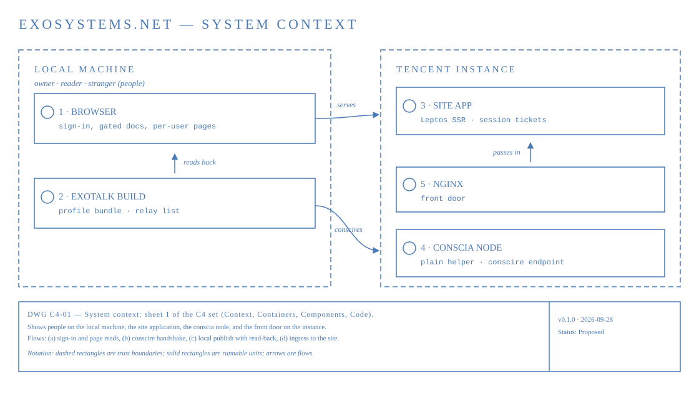

# Conscire the local ExoTalk build with the instance node and prove sync

## Status

Proposed

## Context

The local ExoTalk build is the client that conscires with the
instance Conscia node and syncs. Consciring is the relationship
handshake between an exotalk identity and a conscia node: the exotalk
presents their `did:peer`, the node's owner approves under the
node's own policies, and the two stay in sync afterwards. The
mechanism is the join flow in Spec 11 §11.4. Signing in gates the
docs view through identity, node, and synced storage, for the author
account, the reader account, and the refused stranger.

## Decision

Consciring steps through the Conscia node's conscire endpoint: the
local build presents the user `did:peer` with the powers requested
for the namespaces in `keep-local-synced-willow-store.md`; the node
verifies ownership via the sign-in challenge, its owner approves,
the node records the capability, and confirms; the build keeps the
node in its relay list.

Proof is end to end and ordered: conscire with the author account,
publish a test entry locally, sync, and read it back through the
gated docs view; repeat for the reader account; confirm the stranger
stays refused; revoke the test capability and confirm sync stops
carrying its namespaces. Each step runs in a real browser against
the live instance; server-rendered output alone settles nothing.

## Consequences

A passing run proves identity, node, and synced storage as one gate
for three accounts. The relay list becomes the visible record of
conscired nodes on the profile page. Revocation behavior is
verified, not assumed. Node-side conscire handling defects surface
here rather than in the website lane; failures route to the node
record, not to the sign-in flow.
