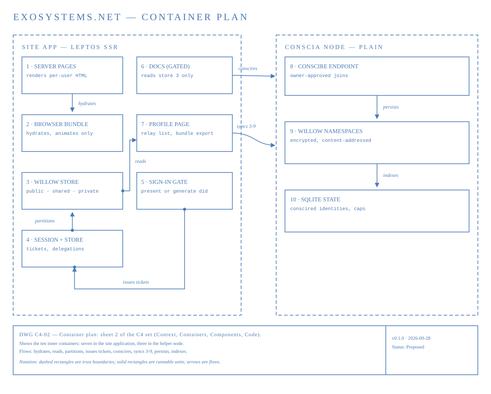

# Keep a local synced Willow store per signed-in identity

## Status

Proposed

## Context

Pages on exosystems.net assemble per signed-in user from that user's
synced content; the gated docs view is the first such page (record:
`exosystems-exoauth.md`). Sessions resolve three local stores —
public, shared-by-permission, private. The instance Conscia node holds
encrypted user content in Willow namespaces and forwards on
connection. Willow is the content-addressed sync layer shared by node and client.
The client side below names which namespaces the local application
keeps, when it syncs, and what counts as synced.

## Decision

The application keeps one local Willow store per signed-in identity,
with the same three partitions as the session model: public,
shared-by-permission, private. Namespace keys derive from the identity
(`did:peer`), so switching identity switches the visible store with
no cross-identity reads. The store syncs against the conscired instance
node on sign-in and on node reconnect; reads for page assembly come
from the local store only, never from a live node query, so pages
render offline from last-synced state. Writes land locally first and
propagate to the node on the next sync.
Sync state per namespace is
recorded (last reconciled point) and surfaced on the profile page;
unreconciled writes are marked pending, never silently dropped.

## Consequences

Page assembly has a single source: the local store for the active
identity. Offline reads work from last-synced state. The sign-in gate
depends on this store existing — without it the gate cannot resolve
the three partitions. Sync cadence beyond sign-in and reconnect
(interval sync, background sync) is an open follow-on; conflict
merges across devices are out of scope until multi-device sync is
exercised through the Profile Bundle (record:
`recover-and-move-exotalk-profile-across-devices.md`).